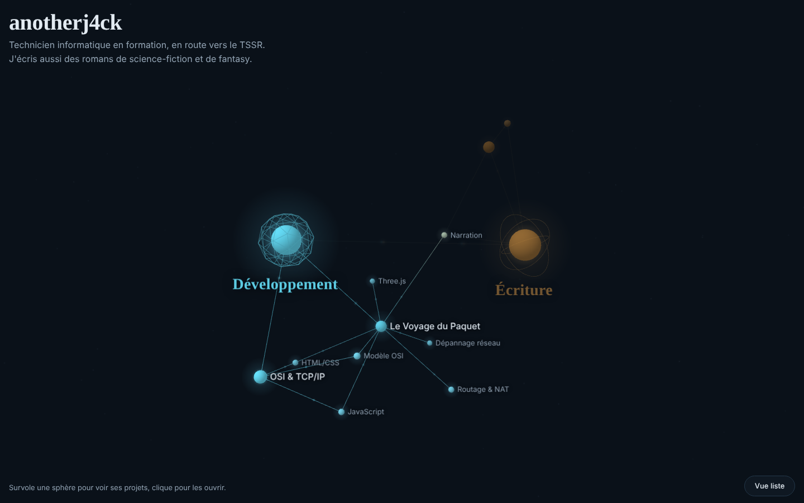

# anotherj4ck · portfolio

Mon portfolio, sous forme de graphe 3D vivant. Deux sphères au centre : **Développement** et **Écriture**. Autour, mes projets et les compétences qu'ils mettent en pratique. On survole une sphère pour voir ses projets, on clique pour ouvrir une fiche avec le lien vers le site et vers le code.

**Démo :** https://anotherj4ck.github.io/



## Ce que fait la page

- Une scène 3D en Three.js : les nœuds flottent, se repoussent, et on peut les attraper pour les déplacer.
- Survol d'une sphère : ses projets et leurs compétences s'allument, le reste s'estompe.
- Clic sur un nœud : une fiche s'ouvre (description, technologies, liens).
- Des petits « paquets » lumineux circulent sur les liens, en clin d'œil au réseau.
- Une **vue liste** sans 3D, pour aller vite, pour le clavier et les lecteurs d'écran.
- Sur téléphone, le toucher remplace le survol et les deux sphères s'empilent verticalement.
- Si le système demande de réduire les animations, la scène reste immobile.

## Ajouter un projet

Tout le contenu est dans [`graph.json`](graph.json). Le code n'a pas besoin de changer.

1. Ajoute un nœud de type `project`, rattaché à une sphère avec `hub` :

```json
{
  "id": "mon-projet",
  "type": "project",
  "hub": "dev",
  "title": "Mon projet",
  "short": "Une phrase qui donne envie de cliquer.",
  "description": "Ce que fait le projet, ce que j'ai appris.",
  "tech": ["PowerShell"],
  "site": "https://anotherj4ck.github.io/mon-projet/",
  "repo": "https://github.com/anotherj4ck/mon-projet"
}
```

2. Relie-le à sa sphère et à ses compétences dans `links` :

```json
{ "source": "dev", "target": "mon-projet" },
{ "source": "mon-projet", "target": "powershell" }
```

Une compétence est un nœud de type `skill`. Règle que je me fixe : pas de compétence sans un projet qui la prouve.

## Lancer en local

Le navigateur refuse de lire `graph.json` quand on ouvre `index.html` en double-cliquant (sécurité des fichiers locaux). Il faut un petit serveur web :

```bash
# Linux ou Windows, depuis le dossier du dépôt
python3 -m http.server 8000      # sous Windows : py -m http.server 8000
```

Puis ouvrir http://localhost:8000. Dans VS Code, l'extension *Live Server* fait la même chose.

## Choix techniques

| Choix | Pourquoi |
|---|---|
| HTML, CSS et JavaScript sans framework ni étape de build | Le site est petit. GitHub Pages le sert tel quel. |
| Three.js r128 chargé depuis cdnjs | Dernière version distribuée en script classique. Même base que *Le Voyage du Paquet*. |
| Simulation physique écrite à la main | Une quinzaine de nœuds : une répulsion en 1/d², des ressorts sur les liens et un ancrage des deux sphères suffisent. Je maîtrise chaque ligne. |
| Contenu séparé dans `graph.json` | On sépare les données de l'affichage : ajouter un projet ne touche pas au code. |
| Textes insérés avec `textContent`, liens limités à `https://` | Un contenu du JSON ne peut pas devenir du code exécuté dans la page (pas d'injection). |
| Étiquettes en HTML par-dessus la 3D | Texte net à toutes les tailles, sélectionnable, et vrai rendu des polices. |

## Arborescence

```
.
├── index.html     structure de la page
├── style.css      mise en forme (thème sombre, version téléphone)
├── main.js        scène 3D, physique, interactions
├── graph.json     le contenu : sphères, projets, compétences, liens
└── docs/          captures pour ce README
```

## Mes projets dans le graphe

- [Le Voyage du Paquet](https://github.com/anotherj4ck/le-voyage-du-paquet) : le trajet d'un paquet réseau, en 3D, avec un jeu de dépannage.
- [OSI & TCP/IP](https://github.com/anotherj4ck/osi-tcpip) : les couches réseau, une par une.
- [Site d'auteur](https://github.com/anotherj4ck/auteur) : mes quatre univers de fiction, avec galeries de personnages.
- [Le Codex du Greatland](https://anotherj4ck.github.io/auteur/codex.html) : l'archive illustrée de mon univers de fantasy.

## Licence

[MIT](LICENSE)
